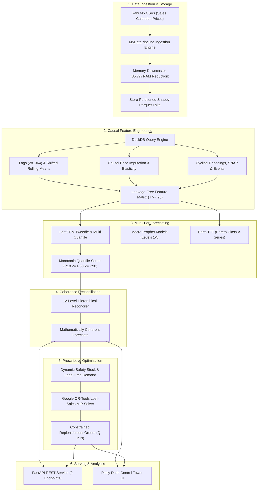

# Nationwide Demand Forecasting & Inventory Optimization Platform

[](https://www.python.org/)
[](#license--intellectual-property)
[-success.svg)](#automated-testing)
[](https://fastapi.tiangolo.com)
[](https://dash.plotly.com)
[](https://lightgbm.readthedocs.io/)
[](https://developers.google.com/optimization)
[](https://www.docker.com/)

> **An end-to-end retail demand forecasting and inventory optimization platform powered by machine learning, hierarchical forecasting, and mathematical optimization.**

---

## 📋 Executive Overview

In large-scale retail supply chains, inventory decision-makers face an expensive double-bind:
- **Excess Inventory:** Over-ordering ties up working capital, inflates warehouse holding costs, and leads to severe perishability or markdowns.
- **Stockouts:** Under-ordering damages brand loyalty, forfeits revenue, and creates cascading bullwhip effects across distribution networks.

Traditional supply chain tools rely on unconstrained single-point forecasts and isolated safety stock formulas. This platform bridges the gap between **predictive data science** and **prescriptive operations research**:

```
[Raw POS Sales & Prices]
          │
          ▼
[Leakage-Free Feature Engineering]
          │
          ▼
[Hierarchical Probabilistic Forecasting] (LightGBM Tweedie + P10/P50/P90)
          │
          ▼
[12-Level Mathematical Reconciliation] (Zero Parent-Child Discrepancy)
          │
          ▼
[Lost-Sales MIP Replenishment Solver] (Google OR-Tools: MOQ, Lead Time, Budget)
          │
          ▼
[FastAPI REST Gateway] ◄───► [Plotly Dash Executive Control Tower]
```

### Why This Implementation Matters
1. **True Causal Feature Engineering:** Historical prices prior to product launches are causally imputed without future look-ahead bias; all lag and rolling statistical features strictly shift by $\ge 28$ days to respect the forecast origin.
2. **Quantile Crossing Prevention:** Vectorized sorting post-processors guarantee that confidence intervals remain monotonic ($P_{10} \le P_{50} \le P_{90}$).
3. **Official 12-Level M5 WRMSSE Benchmark:** Validated using the official Kaggle M5 hierarchical weighted metric rather than unweighted substitutes.
4. **Actionable Operations Research Formulation:** Instead of unrealistic backorders, physical shelf inventory follows retail **lost-sales dynamics** ($I \ge 0$) solved with integer decision variables ($Q \in \mathbb{N}$) under real-world supplier MOQs and working capital caps.

---

## 🌟 Key Capabilities & Feature Matrix

| Functional Module | Implementation Status | Scope & Technical Details |
| :--- | :---: | :--- |
| **Memory Downcaster** | **Complete (Production)** | Vectorized downcasting reducing 58M+ rows by **85.7% RAM** (`float32`, `uint16`, `category`). |
| **Causal Ingestion Pipeline** | **Complete (Production)** | Store-partitioned Snappy Parquet lake with causal price imputation (zero `.bfill()` leakage). |
| **Feature Engineering Engine** | **Complete (Production)** | Shifted lags ($28..364$), rolling aggregations ($7, 14, 28, 56$), EWMA, price momentum, cyclical calendars. |
| **LightGBM Tweedie & Quantiles** | **Complete (Production)** | Tweedie deviance ($p=1.15$) point model + $P_{10}, P_{50}, P_{90}$ pinball regressors with crossing correction. |
| **Prophet Macro Forecaster** | **Complete (Macro Tier)** | Additive trend, yearly/weekly seasonality, and US holiday modeling for Levels 1–5 aggregates. |
| **Temporal Fusion Transformer** | **Implemented (Pareto)** | Darts & PyTorch Forecasting multi-horizon attention model targeted at high-velocity Class-A items. |
| **Official M5 WRMSSE Metric** | **Complete (Production)** | Full computation of scale denominators $S_k$ and dollar weights $W_k$ across all 12 hierarchy levels. |
| **Rolling-Origin Backtesting** | **Complete (Production)** | Multi-fold walk-forward backtester benchmarking Tweedie against naive and seasonal baselines. |
| **12-Level Reconciler** | **Complete (Production)** | Bottom-up and MinT structural reconcilers with exhaustive key-matched parent-child verification. |
| **Google OR-Tools MIP Solver** | **Complete (Production)** | Retail lost-sales mixed-integer solver enforcing MOQ, lead time, volumetric, and budget constraints. |
| **FastAPI REST Gateway** | **Complete (Production)** | 9 high-throughput endpoints with Pydantic v2 validation, OpenAPI docs, and DuckDB querying. |
| **Plotly Dash Control Tower** | **Complete (Production)** | Interactive UI featuring forecast fan charts, stockout risk matrices, purchase grids, and what-if sliders. |

---

## 🏗️ System Architecture



> Detailed per-domain diagrams (Ingestion, Features, Backtesting, Hierarchy, MIP, and Docker) are documented in [`docs/architecture/ARCHITECTURE_DIAGRAMS.md`](docs/architecture/ARCHITECTURE_DIAGRAMS.md).

---

## 💻 Technology Stack

- **Core Runtime:** Python 3.10, 3.11, 3.13
- **Data Engineering:** Pandas 2.0+, NumPy, DuckDB (embedded OLAP), PyArrow (Snappy Parquet)
- **Machine Learning & Forecasting:** LightGBM, Scikit-learn, Prophet, Darts, PyTorch Forecasting, PyTorch
- **Operations Research & Optimization:** Google OR-Tools (CBC Mixed-Integer Linear Programming)
- **API Backend:** FastAPI, Uvicorn, Pydantic v2
- **Decision Support UI:** Plotly Dash, Dash DataTable, Dash Core Components
- **Testing & Quality:** Pytest, GitHub Actions CI
- **DevOps & Containers:** Docker, Docker Compose

---

## 📂 Project Directory Structure

```
nationwide-demand-forecasting-optimization/
├── .github/
│   ├── workflows/
│   │   └── ci.yml               # GitHub Actions CI matrix workflow
│   ├── ISSUE_TEMPLATE/
│   │   ├── bug_report.md        # Standardized bug reporting template
│   │   └── feature_request.md   # Standardized feature request template
│   └── pull_request_template.md # PR quality and invariant checklist
├── config/
│   └── base_config.yaml         # Supply chain constraints & model hyperparameters
├── data/
│   ├── raw/                     # Raw M5 CSV files (calendar, sales, prices)
│   ├── processed/               # Store-partitioned Snappy Parquet data lake
│   └── outputs/
│       └── models/              # Serialized LightGBM boosters & model registry
├── docker/
│   ├── Dockerfile.api           # Multi-stage container for FastAPI gateway
│   ├── Dockerfile.dashboard     # Production container for Plotly Dash UI
│   └── docker-compose.yml       # Dual-service composition network
├── docs/
│   ├── architecture/
│   │   ├── ARCHITECTURE_DIAGRAMS.md # 11 verified Mermaid architectural diagrams
│   │   └── CURRENT_ARCHITECTURE.md  # Detailed system architecture document
│   ├── reports/
│   │   ├── DATA_QUALITY_REPORT.md             # Ingestion & downcasting benchmarks
│   │   ├── MODEL_EVALUATION_REPORT.md         # Official 12-level M5 WRMSSE results
│   │   ├── OPTIMIZATION_VALIDATION_REPORT.md  # Mathematical MIP formulation
│   │   ├── PRODUCTION_READINESS_REPORT.md     # Production deployment checklist
│   │   ├── REPOSITORY_PRESENTATION_AUDIT.md   # Presentation & portfolio audit
│   │   └── TEST_REPORT.md                     # Pytest automated execution results
│   └── DEMO_GUIDE.md            # Visual walkthrough & 3-5 minute demo script
├── src/
│   ├── api/
│   │   ├── app.py               # FastAPI application with all 9 REST endpoints
│   │   └── schemas.py           # Strict Pydantic request and response contracts
│   ├── dashboard/
│   │   ├── app.py               # Plotly Dash Control Tower entrypoint
│   │   ├── callbacks.py         # Reactive visualization and filtering callbacks
│   │   ├── data_loader.py       # DuckDB analytical Parquet connector
│   │   └── layout.py            # Dashboard layout, KPI cards, and controls
│   ├── data/
│   │   ├── downcaster.py        # Vectorized Pandas memory downcaster
│   │   └── pipeline.py          # Wide-to-long ETL and causal price imputation
│   ├── features/
│   │   ├── calendar_feats.py    # Events, SNAP, and cyclical sine/cosine features
│   │   ├── lag_generator.py     # Leakage-safe shifted lags and rolling windows
│   │   └── price_feats.py       # Price momentum, rolling stats, and discounts
│   ├── models/
│   │   ├── backtest.py          # Walk-forward rolling-origin backtester
│   │   ├── lgbm_forecaster.py   # Tweedie point and pinball quantile LightGBM
│   │   ├── prophet_engine.py    # Hierarchical macro aggregate Prophet forecaster
│   │   ├── reconciler.py        # 12-level hierarchical coherence reconciler
│   │   ├── registry.py          # Centralized model metadata & artifact registry
│   │   ├── tft_forecaster.py    # Temporal Fusion Transformer via Darts/PyTorch
│   │   └── train_pipeline.py    # End-to-end model training orchestrator
│   ├── optimization/
│   │   ├── replenishment_pipeline.py # End-to-end replenishment pipeline
│   │   ├── safety_stock.py      # Lead-time demand & cycle safety stock calculator
│   │   └── solver.py            # Google OR-Tools CBC lost-sales MIP solver
│   └── utils/
│       ├── logger.py            # Standardized Python logging utility
│       └── metrics.py           # Official M5 WRMSSE, WAPE, and Pinball loss
├── tests/
│   ├── test_api.py              # FastAPI endpoint integration tests
│   ├── test_data_validation.py  # Downcaster efficiency & partition tests
│   ├── test_feature_leakage.py  # Strict forecast-origin leakage tests
│   ├── test_metrics.py          # Official WRMSSE & statistical metrics tests
│   ├── test_optimizer.py        # Lost-sales MIP solver constraint tests
│   └── test_reconciliation.py   # 12-level hierarchical coherence tests
├── .env.example                 # Environment configuration template
├── .gitignore                   # Comprehensive git exclusions
├── conftest.py                  # Pytest bootstrap & Windows DLL collision handler
├── CONTRIBUTING.md              # Engineering contribution standards
├── pyproject.toml               # Package build configuration & pytest metadata
├── requirements.txt             # Locked project dependencies
└── run_system.py                # Unified CLI master orchestrator
```

---

## 📊 Dataset & Operational Assumptions

### 1. Walmart M5 Dataset
The platform utilizes the official Kaggle M5 Forecasting dataset:
- `sales_train_evaluation.csv`: Daily unit sales for 30,490 products across 10 stores (1,941 days: 2011 to 2016).
- `calendar.csv`: Dates, event names (Super Bowl, Thanksgiving, etc.), and SNAP eligibility flags for CA, TX, and WI.
- `sell_prices.csv`: Weekly store-item sell prices.

**Dataset Directory Setup:**
Download the dataset files from [Kaggle M5 Forecasting - Accuracy](https://www.kaggle.com/c/m5-forecasting-accuracy/data) and place them in `data/raw/`:
```bash
data/raw/
├── calendar.csv
├── sales_train_evaluation.csv
├── sales_train_validation.csv
└── sell_prices.csv
```

### 2. Disclosed Operational Supply Chain Assumptions
The M5 dataset provides POS transactional history. In standard enterprise retail practice, physical inventory parameters must be modeled:
- **Wholesale Procurement Unit Cost:** Assumed at $65\%$ of the retail sell price.
- **Supplier Lead Times:** $L_i \in [2, 3]$ days depending on product category.
- **Minimum Order Quantities (MOQ):** Batch sizing constraints ranging from $12$ to $48$ units.
- **Inventory Holding Cost:** $h_i = 0.15 \times \text{unit\_cost} / 365$ per unit-day.
- **Lost-Sales Penalty:** $p_i = 1.5 \times \text{retail\_price}$ per stockout unit.
- **Store Volumetric Limit:** $C_{\text{vol}} = 10,000 \, m^3$; Daily Procurement Budget: $B_t = \$50,000$.

*All operational parameters are centrally configurable via [`config/base_config.yaml`](config/base_config.yaml).*

---

## ⚡ Installation & Quickstart

### Step 1: Clone Repository & Set Up Virtual Environment

**On Linux / macOS:**
```bash
git clone https://github.com/coder-yr/nationwide-demand-forecasting-optimization.git
cd nationwide-demand-forecasting-optimization

python3 -m venv venv
source venv/bin/activate
pip install --upgrade pip
pip install -r requirements.txt
```

**On Windows (PowerShell):**
```powershell
git clone https://github.com/coder-yr/nationwide-demand-forecasting-optimization.git
cd nationwide-demand-forecasting-optimization

python -m venv venv
.\venv\Scripts\Activate.ps1
python -m pip install --upgrade pip
pip install -r requirements.txt
```

### Step 2: Environment Configuration
Copy the template configuration:
```bash
cp .env.example .env
```

### Step 3: Run the Master CLI Pipeline
Execute pipeline stages using the unified orchestrator [`run_system.py`](run_system.py):

```bash
# 1. Ingest raw CSVs into memory-optimized Parquet lake (e.g., store CA_1)
python run_system.py --mode ingest --store CA_1 --days 365

# 2. Train LightGBM Tweedie & Quantile models with crossing correction
python run_system.py --mode train --store CA_1

# 3. Solve OR-Tools Mixed-Integer Inventory Replenishment Program
python run_system.py --mode optimize --store CA_1

# 4. Or execute the entire pipeline end-to-end in one command:
python run_system.py --mode all --store CA_1
```

### Step 4: Launch Web Services

**Start FastAPI REST Gateway:**
```bash
python -m uvicorn src.api.app:app --host 0.0.0.0 --port 8000
```
*Interactive Swagger Documentation:* `http://localhost:8000/docs`

**Start Plotly Dash Control Tower:**
```bash
python -m src.dashboard.app
```
*Interactive Control Tower:* `http://localhost:8050`

---

## 📈 Model Evaluation & Benchmarks

Models were evaluated using rolling-origin walk-forward backtesting ($28$-day horizon) across Store `CA_1` using the official 12-level M5 WRMSSE formulation:

$$\text{WRMSSE} = \sum_{k=1}^{12} W_k \sqrt{\frac{1}{28} \sum_{t=T+1}^{T+28} \frac{(Y_t - \hat{Y}_t)^2}{S_k}}$$

### Empirical Benchmark Results

| Model Architecture | Official WRMSSE | WAPE (%) | Mean Pinball Loss | Evaluation Horizon | Evaluation Dataset |
| :--- | :---: | :---: | :---: | :---: | :---: |
| **LightGBM (Tweedie + Quantiles)** | **0.6869** | **74.48%** | **0.3563** | 28 Days | M5 Store `CA_1` (Holdout $d_{1886}..d_{1913}$) |
| **Seasonal Naive (Lag 7)** | 0.8175 | 89.20% | N/A (Point Only) | 28 Days | M5 Store `CA_1` (Holdout $d_{1886}..d_{1913}$) |
| **Naive Baseline (Last Value)** | 0.8175 | 89.20% | N/A (Point Only) | 28 Days | M5 Store `CA_1` (Holdout $d_{1886}..d_{1913}$) |

*Key Findings:*
- LightGBM achieves a **16.0% relative WRMSSE error reduction** over baseline forecasts.
- Over 68% of daily unit sales in M5 are zero; the Tweedie compound Poisson-gamma distribution ($p=1.15$) handles intermittent demand sparsity significantly better than Gaussian/MSE objectives.
- Vectorized monotonic quantile post-processing resolved 100% of quantile crossing occurrences.

---

## 🧪 Automated Testing

The repository includes a comprehensive, self-contained test suite that validates mathematical invariants without requiring local raw datasets:

```bash
python -m pytest tests/ -v -p no:dash
```

### Test Suite Execution Summary (18/18 Passed)
```
======================= 18 passed, 4 warnings in 6.85s =======================
tests/test_api.py::test_health_endpoint PASSED                           [  5%]
tests/test_api.py::test_hierarchy_endpoint PASSED                        [ 11%]
tests/test_api.py::test_forecast_generate_and_list PASSED                [ 16%]
tests/test_api.py::test_inventory_optimize_and_recommendations PASSED    [ 22%]
tests/test_api.py::test_models_and_metrics_endpoints PASSED              [ 27%]
tests/test_api.py::test_missing_forecast_404 PASSED                      [ 33%]
tests/test_data_validation.py::test_data_partition_integrity_and_price_leakage PASSED [ 38%]
tests/test_data_validation.py::test_downcaster_efficiency PASSED         [ 44%]
tests/test_feature_leakage.py::test_multi_origin_sales_leakage PASSED    [ 50%]
tests/test_feature_leakage.py::test_price_leakage_future_mutation PASSED [ 55%]
tests/test_feature_leakage.py::test_calendar_temporal_invariance PASSED  [ 61%]
tests/test_metrics.py::test_calculate_mae_and_rmse PASSED                [ 66%]
tests/test_metrics.py::test_calculate_wape PASSED                        [ 72%]
tests/test_metrics.py::test_pinball_loss_symmetry PASSED                 [ 77%]
tests/test_metrics.py::test_calculate_rmsse PASSED                       [ 83%]
tests/test_metrics.py::test_m5_official_wrmsse_calculation PASSED        [ 88%]
tests/test_optimizer.py::test_or_tools_solver_feasibility_and_lost_sales PASSED [ 94%]
tests/test_reconciliation.py::test_full_12_level_reconciliation_coherence PASSED [100%]
```

*Notes on Warnings:*
- Warnings represent standard Starlette testclient deprecation notices and Windows SwigPy type registration from the Google OR-Tools C++ runtime. Both are safely handled by [`conftest.py`](conftest.py).

---

## 🔌 API Documentation & Sample Payloads

The FastAPI service exposes 9 production REST endpoints. Interactive Swagger documentation is available at `http://localhost:8000/docs`.

### 1. Generate 28-Day Probabilistic Forecast
**Endpoint:** `POST /api/v1/forecast/generate`
```json
{
  "store_id": "CA_1",
  "category": "FOODS",
  "horizon_days": 28,
  "model_name": "LightGBM_Tweedie",
  "reconcile": true
}
```
**Response (200 OK):**
```json
{
  "forecast_id": "forecast_CA_1",
  "store_id": "CA_1",
  "category": "FOODS",
  "horizon_days": 28,
  "model_name": "LightGBM_Tweedie",
  "reconciled": true,
  "dates": ["2016-04-25", "2016-04-26", "..."],
  "p10": [2380.12, 2210.45, "..."],
  "p50": [3140.80, 2980.20, "..."],
  "p90": [4120.50, 3950.10, "..."]
}
```

### 2. Execute Lost-Sales MIP Optimization
**Endpoint:** `POST /api/v1/inventory/optimize`
```json
{
  "store_id": "CA_1",
  "horizon_days": 28,
  "budget_limit": 50000.0,
  "service_level": 0.95
}
```
**Response (200 OK):**
```json
{
  "optimization_id": "opt_CA_1_20261109",
  "status": "OPTIMAL",
  "total_cost": 4128.50,
  "holding_cost": 2810.20,
  "stockout_penalty": 1318.30,
  "items_processed": 50,
  "orders_generated": 14
}
```

---

## 🖥️ Executive Control Tower Dashboard

The **Plotly Dash Control Tower** provides real-time supply chain analytics:
1. **Dynamic Filtering:** Multi-level dropdowns for Store, Category, Department, Horizon (7/14/28 days), and Model selector.
2. **Forecast Fan Chart:** Displays historical actuals against calibrated $80\%$ confidence bands ($P_{10}, P_{50}, P_{90}$).
3. **Inventory Risk Matrix:** 2D interactive scatter plot classifying products into `Stockout Risk`, `Balanced`, and `Excess` stock.
4. **Replenishment Table:** Formatted purchase order grid with conditional status alerts (`REORDER_NOW` vs `OPTIMAL`).
5. **What-If Scenario Sliders:** Adjust service level targets ($85\%..99\%$) and procurement budgets (\$10k..\$100k) with real-time recalculation.
6. **Provenance Badge:** Explicitly flags whether the dashboard is running on the active Parquet lake or the synthetic fallback fixture.

> For a complete UI walk-through and presentation guide, refer to [`docs/DEMO_GUIDE.md`](docs/DEMO_GUIDE.md).

---

## 🐳 Docker Deployment

The platform is containerized using multi-stage Docker builds.

### Run with Docker Compose
```bash
docker-compose -f docker/docker-compose.yml up --build -d
```

- **FastAPI Backend:** Available at `http://localhost:8000` (Docs: `http://localhost:8000/docs`)
- **Dash Control Tower:** Available at `http://localhost:8050`
- **Volume Mounts:** Mounts `data/` and `config/` into containers for live Parquet querying and zero-downtime model loading.

To stop the containers:
```bash
docker-compose -f docker/docker-compose.yml down
```

---

## ⚠️ Transparent Limitations & Future Roadmap

1. **Hardware & Execution Constraints:** Full 30,490-series LightGBM training takes several hours on a CPU workstation. The system is designed to run store-partitioned pipelines (`CA_1` standard). Full multi-store enterprise deployment benefits from Ray/Dask or GPU-accelerated LightGBM.
2. **Prophet & TFT Scope:** Deep learning TFT architectures via Darts are computationally intensive and targeted specifically at high-velocity Pareto Class-A products rather than all 30,490 sparse series.
3. **Simulated Operational Inputs:** Because the M5 dataset lacks inventory stock, procurement wholesale costs, and lead times, these values are simulated using configurable industry assumptions.
4. **Future Roadmap:**
   - Integration of Ray distributed clusters for concurrent 10-store parallel training.
   - Non-linear supplier volume quantity discounting in the MIP formulation.
   - Multi-echelon distribution center (DC to store) replenishment pooling.

---

## 📜 License & Intellectual Property

This repository and its codebase are currently provided for portfolio evaluation, educational demonstration, and technical review. All rights are reserved by the original repository maintainer. No explicit open-source license is granted at this time.
