# Nationwide Demand Forecasting & Inventory Optimization
## Comprehensive System Architecture Diagrams

This document contains 11 verified Mermaid architectural diagrams modeling the exact data flow, machine learning lifecycle, mathematical reconciliation, optimization mechanics, API routing, and deployment topologies implemented in the platform.

---

### 1. Overall System Architecture

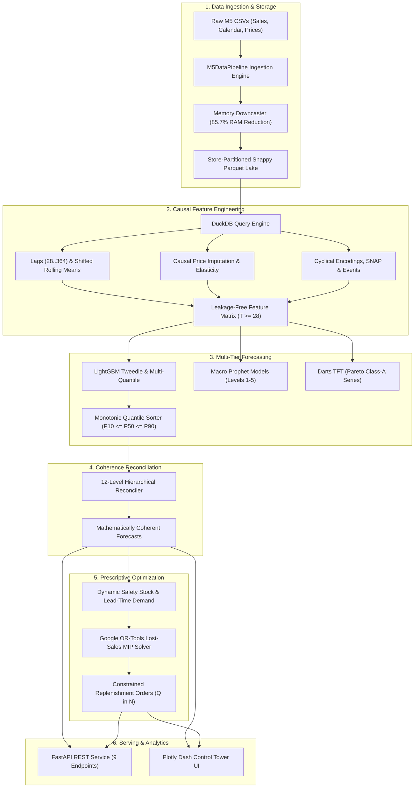

---

### 2. Data Ingestion Pipeline

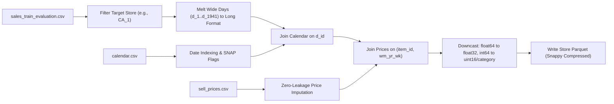

---

### 3. Feature Engineering Workflow

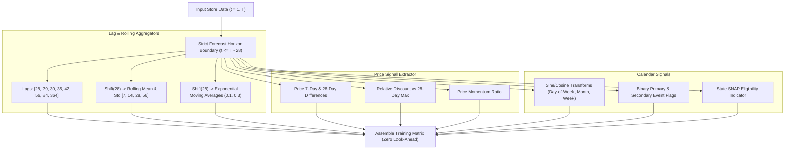

---

### 4. Forecast Model Training Lifecycle

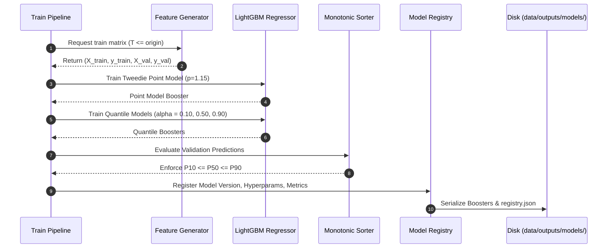

---

### 5. Rolling-Origin Walk-Forward Backtesting

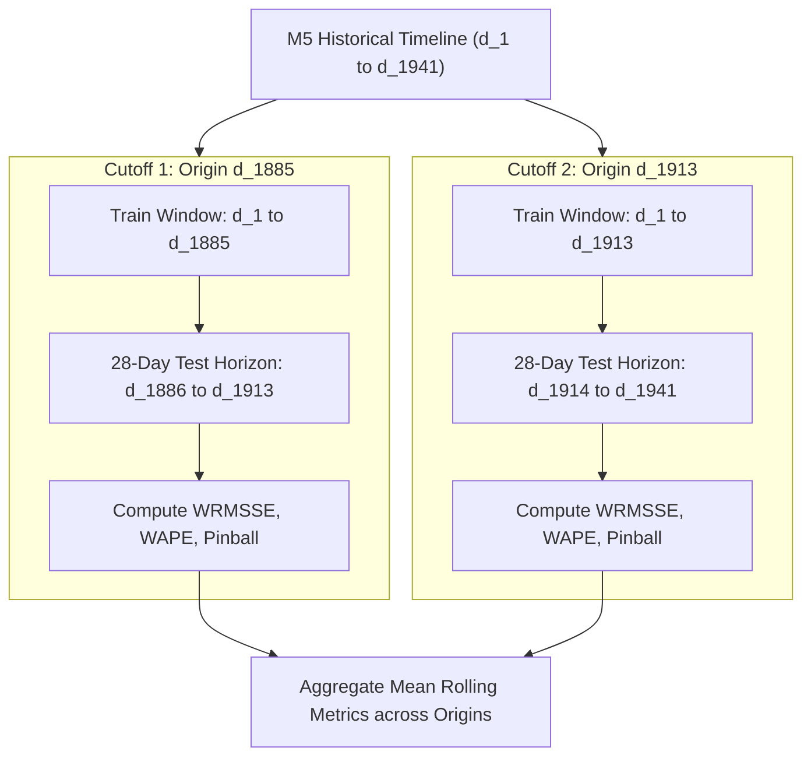

---

### 6. Official M5 12-Level Hierarchy

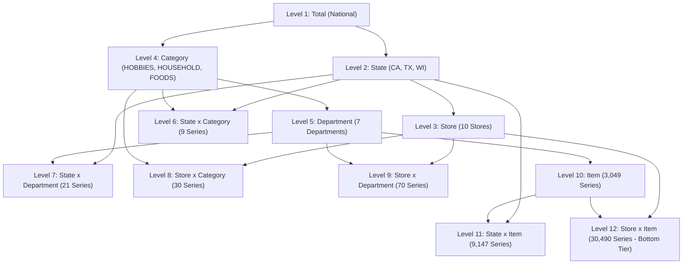

---

### 7. Hierarchical Reconciliation Workflow

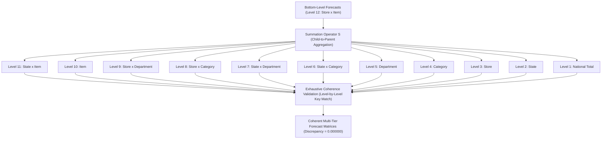

---

### 8. Inventory Optimization Workflow

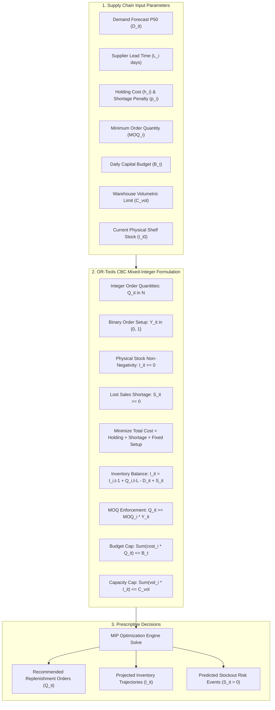

---

### 9. FastAPI Architecture

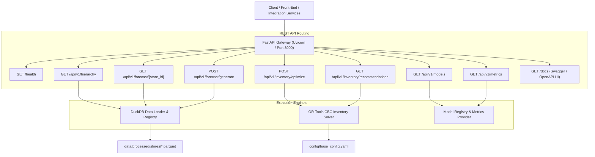

---

### 10. Dashboard Data Flow

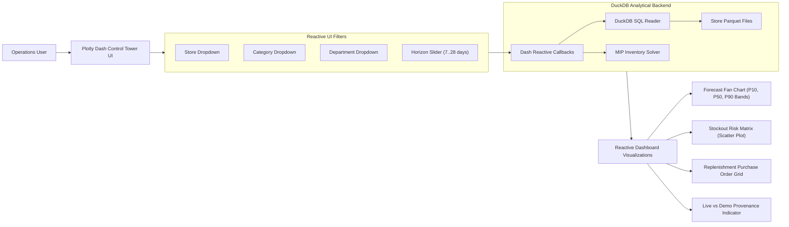

---

### 11. Production Containerized Deployment Architecture

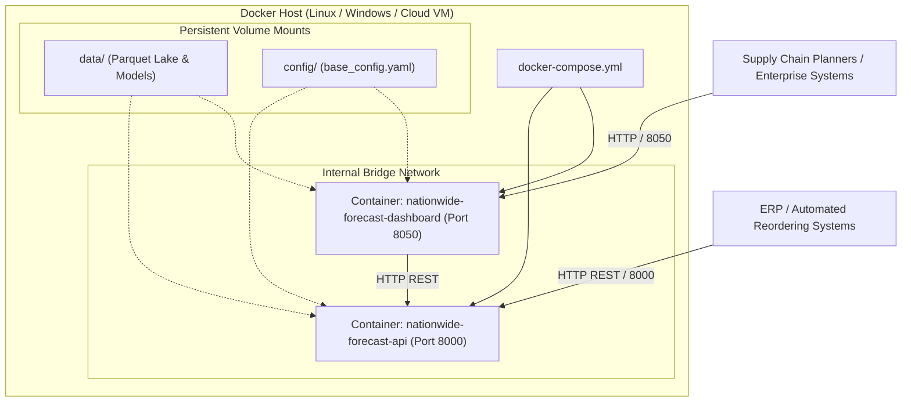

