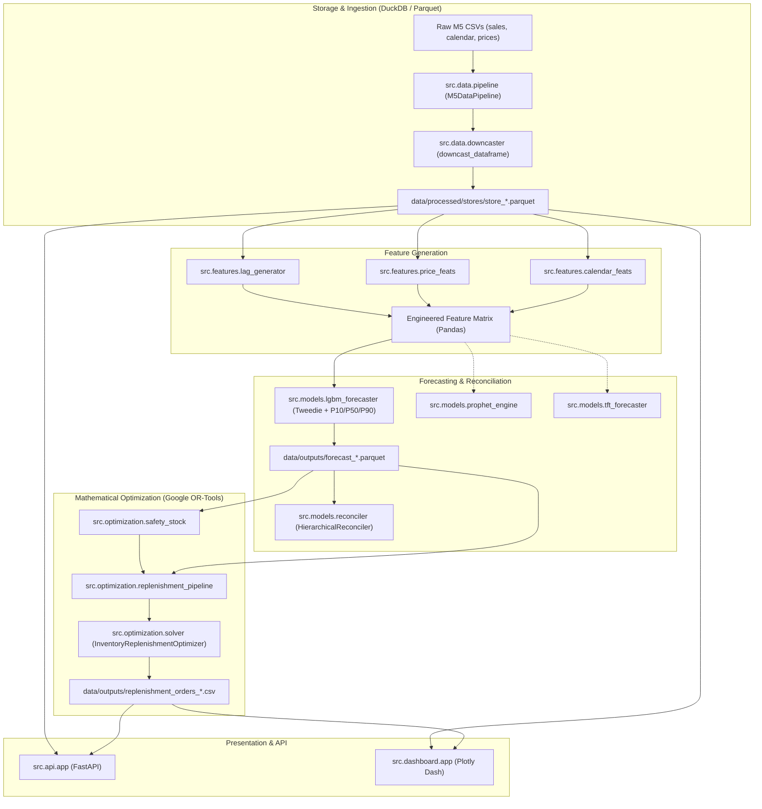

# Current Architecture Specification
**Platform:** Nationwide Demand Forecasting and Inventory Optimization Platform  
**Status:** Post-Audit Baseline  
**Revision:** 1.1  

---

## 1. System Topology & Architectural Overview

The system is organized into a modular pipeline architecture decoupled into discrete engineering stages:
1. **Data Ingestion & Lake Layer**: Downcasts 64-bit wide M5 sales data and writes store-partitioned Snappy Parquet files.
2. **Feature Engineering Layer**: Generates leakage-free lag, rolling, pricing, and cyclical calendar representations.
3. **Multi-Model Forecasting Engine**: Trains LightGBM Quantile and Tweedie regressors, with standalone Prophet and TFT components.
4. **Hierarchical Reconciliation Engine**: Aggregates bottom-level predictions upwards to guarantee cross-sectional coherence.
5. **Inventory Optimization Engine**: Formulates multi-period constrained Mixed-Integer Programs (MIP) in Google OR-Tools.
6. **Delivery & Serving Layer**: Exposes RESTful endpoints via FastAPI and an operational decision support portal via Plotly Dash.



---

## 2. Module Dependency Graph

```
run_system.py (CLI Orchestrator)
 ├── src.data.pipeline (M5DataPipeline)
 │    ├── src.data.downcaster (downcast_dataframe)
 │    └── src.utils.logger
 ├── src.models.train_pipeline (ModelTrainingPipeline)
 │    ├── src.features.lag_generator
 │    ├── src.features.price_feats
 │    ├── src.features.calendar_feats
 │    ├── src.models.lgbm_forecaster (LGBMForecaster)
 │    │    └── src.models.base (BaseForecaster)
 │    ├── src.utils.metrics (calculate_wape, calculate_rmsse, calculate_multi_quantile_loss)
 │    └── src.utils.logger
 └── src.optimization.replenishment_pipeline (ReplenishmentPipeline)
      ├── src.optimization.solver (InventoryReplenishmentOptimizer) [OR-Tools]
      ├── src.optimization.safety_stock (calculate_safety_stock_and_rop)
      └── src.utils.logger

src.api.app (FastAPI Gateway)
 ├── src.api.schemas (Pydantic DTOs)
 ├── src.dashboard.data_loader (DashboardDataLoader via DuckDB)
 ├── src.optimization.safety_stock
 └── src.utils.logger

src.dashboard.app (Plotly Dash Portal)
 ├── src.dashboard.layout (Layout & KPI cards)
 ├── src.dashboard.callbacks (Plotly fan charts & risk scatter)
 └── src.dashboard.data_loader (DuckDB reader)
```

---

## 3. Data Flow and Partitioning Mechanics

1. **Raw Files**:
   * `sales_train_evaluation.csv`: 30,490 rows $\times$ 1,947 columns (wide format).
   * `calendar.csv`: 1,969 days with SNAP flags, events, and calendar mappings.
   * `sell_prices.csv`: Store-item weekly price schedule.
2. **Streaming DuckDB Ingestion**:
   * Reads raw sales filtered by `store_id` directly in SQL, avoiding full 58M row unpivoting in memory.
   * Converts wide `d_1 ... d_1941` columns into a single `sales` column.
   * Merges calendar features and sell prices using hash joins.
   * Downcasts numeric representations:
     * `d_num`, `sales`: `uint16`
     * `wday`, `month`: `uint8`
     * `sell_price`: `float32`
     * `item_id`, `dept_id`, `cat_id`, `store_id`, `state_id`: `category`
3. **Partition Storage**:
   * Partitioned as `data/processed/stores/store_{store_id}.parquet`.
   * Stored using Snappy compression. A 1-year history partition for 3,049 items (~1.11M rows) takes **5.13 MB**.

---

## 4. Feature Engineering Architecture

Features follow strict temporal availability partitions:

| Feature Category | Features Generated | Minimum Shift | Causal Guarantee |
|---|---|---|---|
| **Lags** | `sales_lag_28`, `sales_lag_29`, `sales_lag_35`, `sales_lag_42` | 28 Days | Direct direct-horizon projection without recursive multi-step autoregression. |
| **Shifted Rolling** | `roll_mean_7`, `roll_std_7`, `roll_mean_28`, `roll_std_28` | 28 Days | Shifted by 28 days before window aggregation. |
| **Shifted EWMA** | `ewma_10` ($\alpha=0.10$), `ewma_30` ($\alpha=0.30$) | 28 Days | Shifted by 28 days before exponential weighting. |
| **Price Dynamics** | `sell_price`, `price_max_28d`, `discount_ratio`, `is_discounted`, `price_diff_lag7` | Current / Lagged | Computes relative markdowns against rolling 28-day historical maximum. |
| **Calendar / Events** | `wday`, `month`, `day_of_month`, `is_weekend`, `sin_wday`, `cos_wday`, `sin_month`, `cos_month`, `snap_current_state` | Known Exogenous | Deterministic astronomical calendar and public SNAP schedules. |

---

## 5. Forecasting & Optimization Engine Design

### 5.1 LightGBM Quantile & Tweedie Multi-Head Forecaster
* Point Forecast: LightGBM trained with `objective="tweedie"` ($p=1.15$) on item unit counts.
* Uncertainty Intervals: 3 separate LightGBM boosters trained with `objective="quantile"` and $\alpha \in \{0.10, 0.50, 0.90\}$.
* Output Schema: Parquet containing `item_id`, `date`, `d_num`, `point_pred`, `p10`, `p50`, `p90`.

### 5.2 OR-Tools Constrained Mathematical Model
* **Solver**: SCIP / CBC via Google OR-Tools.
* **Decision Variables**:
  * $Q[i, t] \ge 0$: Units ordered on day $t$.
  * $Y[i, t] \in \{0, 1\}$: Binary order trigger.
  * $I_{pos}[i, t] \ge 0$: On-hand ending inventory.
  * $I_{neg}[i, t] \ge 0$: Unmet demand (lost sales / shortages).
* **Constraints**:
  1. $Q[i, t] \ge \text{MOQ}_i \cdot Y[i, t]$ (Minimum Order Quantity).
  2. $Q[i, t] \le M \cdot Y[i, t]$ (Big-M upper ceiling).
  3. $\sum_i V_i \cdot I_{pos}[i, t] \le \text{MaxVolume}$ (Warehouse volume capacity).
  4. $\sum_i c_{unit, i} \cdot Q[i, t] \le \text{DailyBudget}$ (Working capital expenditure limit).

---

## 6. Serving Layer Architecture

### 6.1 FastAPI REST Gateway (`src/api/app.py`)
* Endpoints:
  * `GET /api/v1/health`: Cluster & data lake status.
  * `GET /api/v1/hierarchy/tree`: Multi-level structural node list.
  * `POST /api/v1/forecast/generate`: On-demand 28-day quantile generation.
  * `POST /api/v1/optimize/replenish`: Constrained replenishment optimization.

### 6.2 Plotly Dash Portal (`src/dashboard/app.py`)
* Reactive Single Page Application:
  * Executive KPI row (Demand, Stockout Risk, Working Capital, Service Level).
  * Shaded $P_{10}-P_{50}-P_{90}$ forecast fan chart.
  * Risk matrix scatter plot (identifying critical stockouts in red, optimal buffer in green, excess stock in yellow).
  * Interactive purchase order review and approval table.
  * Dynamic sliders for service level ($\beta = 85\% - 99\%$), budget, and lead times.

