# Implementation & Hardening Roadmap
**Project:** Nationwide Demand Forecasting and Inventory Optimization Platform  
**Target:** Production Hardening & Full Mathematical Correctness  
**Strategy:** Phased, Non-Destructive, Test-Driven Execution  

---

## Roadmap Overview & Phase Dependencies

```mermaid
flowchart TD
    P1["Phase 1: Data Engineering & Integrity\n• Remove causal price bfill() leakage\n• Automated Data Quality Report\n• Schema & anomaly validators"] --> P2["Phase 2: Leakage-Free Feature Engineering\n• Add lags 56, 84, 364 & rolling 56d\n• Add week, year, event_2 encodings\n• Comprehensive test_feature_leakage.py"]
    
    P2 --> P3["Phase 3: Forecasting Model Engine\n• Quantile crossing monotonic correction\n• Model serialization & model registry\n• Benchmarked baseline vs Prophet vs LightGBM\n• TFT integration on Pareto Class-A"]
    
    P3 --> P4["Phase 4: Backtesting & WRMSSE Evaluation\n• Official 12-level M5 WRMSSE engine\n• Multi-origin rolling-window backtest\n• Model comparison report & calibration"]
    
    P4 --> P5["Phase 5: Full 12-Level Hierarchical Reconciliation\n• All 12 M5 structural aggregation tiers\n• Bottom-Up & MinT / Structural WLS\n• Exact mathematical coherence validation tests"]
    
    P5 --> P6["Phase 6: Mathematical Inventory Optimization\n• Fix lost-sales non-negative balance constraint\n• True integer decision variables\n• Explicit documented simulated operational inputs\n• Replenishment order recommendation engine"]
    
    P6 --> P7["Phase 7: FastAPI Integration & Hardening\n• Complete 9 REST endpoints from specification\n• Secure CORS origins\n• Real health check & structured error handling"]
    
    P7 --> P8["Phase 8: Plotly Dash Integration\n• Remove hardcoded placeholder KPIs\n• Multi-filter hierarchy drill-down\n• Live connection to persisted artifacts"]
    
    P8 --> P9["Phase 9: Persistence, Tests & CI/CD Hardening\n• Unit, integration & latency benchmarks\n• Docker & Docker Compose validation\n• Final documentation & readiness report"]
```

---

## Detailed Phase Breakdown & Acceptance Criteria

### Phase 1: Data Engineering & Data Integrity
* **Target Files**: `src/data/pipeline.py`, `src/data/downcaster.py`, `docs/reports/DATA_QUALITY_REPORT.md`
* **Tasks**:
  1. Fix the critical price leakage bug: Eliminate `bfill()` on historical sell prices. Impute unobserved pre-launch prices with NaN/0.0 and create an `is_active_item` flag.
  2. Implement data validation checks: Schema validation, null counts, duplicate ID checks, price negative/zero anomalies.
  3. Generate an automated, reproducible `DATA_QUALITY_REPORT.md` with dataset stats, missingness, and ingestion timings.
* **Acceptance Criteria**: Data pipeline runs with zero future-price leakage; data validation test passes.

### Phase 2: Leakage-Free Feature Engineering
* **Target Files**: `src/features/lag_generator.py`, `src/features/price_feats.py`, `src/features/calendar_feats.py`, `tests/test_feature_leakage.py`
* **Tasks**:
  1. Add required lags: 28, 29, 30, 35, 42, 56, 84, 364.
  2. Add rolling windows: 7, 14, 28, 56 days (strictly shifted by horizon $H \ge 28$).
  3. Add calendar features: Week of year (`isocalendar`), Year, `event_name_2`, `event_type_2`.
  4. Write comprehensive multi-origin leakage tests in `tests/test_feature_leakage.py`.
* **Acceptance Criteria**: All engineered features respect forecast origin $T$; leakage tests pass across multiple origins.

### Phase 3: Forecasting Model Engine & Model Registry
* **Target Files**: `src/models/lgbm_forecaster.py`, `src/models/base.py`, `src/models/prophet_engine.py`, `src/models/tft_forecaster.py`, `src/models/registry.py`
* **Tasks**:
  1. Add quantile crossing post-processing in `lgbm_forecaster.py`: Enforce $P_{10} \le P_{50} \le P_{90}$ via monotonic sorting.
  2. Implement persistent artifact serialization (`save()` and `load()`) for model reuse in the API without retraining.
  3. Create central model registry tracking model versions, training metadata, and hyperparameters.
  4. Integrate Prophet and TFT for comparison on designated subsets.
* **Acceptance Criteria**: Model serializes and reloads cleanly; quantile crossing is eliminated; models follow identical output schemas.

### Phase 4: Backtesting & Official 12-Level WRMSSE
* **Target Files**: `src/utils/metrics.py`, `src/models/backtest.py`, `docs/reports/MODEL_EVALUATION_REPORT.md`
* **Tasks**:
  1. Implement official M5 WRMSSE metric: Computes scale denominators $S_k$ and dollar-revenue weights $W_k$ across all 12 hierarchy levels.
  2. Implement rolling-origin walk-forward backtesting across multiple cutoffs (e.g. $d\_1885, d\_1913$).
  3. Benchmark Naive baseline, Seasonal Naive baseline, LightGBM, and Prophet.
  4. Output `docs/reports/MODEL_EVALUATION_REPORT.md`.
* **Acceptance Criteria**: WRMSSE passes verification against competition benchmark formula; model comparison generated.

### Phase 5: Complete 12-Level Hierarchical Reconciliation
* **Target Files**: `src/models/reconciler.py`, `tests/test_reconciliation.py`
* **Tasks**:
  1. Implement all 12 M5 aggregation levels: Total, State, Store, Category, Department, State $\times$ Cat, State $\times$ Dept, Store $\times$ Cat, Store $\times$ Dept, Item, State $\times$ Item, Store $\times$ Item.
  2. Implement Bottom-Up aggregation and structural MinT-WLS reconciliation.
  3. Build comprehensive parent-child key coherence validation tests.
* **Acceptance Criteria**: Coherence check verifies that child series sum exactly to parent series across all 12 levels with zero discrepancy.

### Phase 6: Inventory Optimization Engine Correction
* **Target Files**: `src/optimization/solver.py`, `src/optimization/replenishment_pipeline.py`, `tests/test_optimizer.py`
* **Tasks**:
  1. Fix the lost-sales mathematical formulation: Replace backorder carryover ($I_{pos} - I_{neg}$) with true retail lost-sales equations where starting shelf inventory is $\max(0, I_{t-1}) = I_{pos}[t-1]$.
  2. Use integer decision variables (`solver.IntVar`) for physical order quantities and inventory units.
  3. Formulate and enforce supplier lead-time arrival delays, MOQ, warehouse capacity ($m^3$), and daily capital budget.
  4. Disclose and configure all operational simulation assumptions in `base_config.yaml`.
* **Acceptance Criteria**: Solver outputs feasible integer replenishment plans honoring capacity, budget, and MOQ without phantom negative inventory.

### Phase 7: FastAPI Backend Integration & Security Hardening
* **Target Files**: `src/api/app.py`, `src/api/schemas.py`, `tests/test_api.py`
* **Tasks**:
  1. Implement all required endpoints:
     * `GET /health` (validates disk/data lake/model availability)
     * `GET /api/v1/hierarchy`
     * `GET /api/v1/forecasts`
     * `POST /api/v1/forecasts/generate`
     * `GET /api/v1/forecasts/{forecast_id}`
     * `POST /api/v1/inventory/optimize`
     * `GET /api/v1/inventory/recommendations`
     * `GET /api/v1/models`
     * `GET /api/v1/metrics`
  2. Restrict CORS origins to configured domains (remove wildcard `*`).
  3. Write full API integration tests with `TestClient`.
* **Acceptance Criteria**: All 9 endpoints return valid status codes and conform to Pydantic schemas; tests pass.

### Phase 8: Plotly Dash Integration & Provenance
* **Target Files**: `src/dashboard/app.py`, `src/dashboard/layout.py`, `src/dashboard/callbacks.py`, `src/dashboard/data_loader.py`
* **Tasks**:
  1. Eliminate all static placeholder KPIs; bind all metrics to live persisted model outputs.
  2. Implement full hierarchical filter cascade: State $\rightarrow$ Store $\rightarrow$ Department $\rightarrow$ Category $\rightarrow$ Item $\rightarrow$ Model.
  3. Add clear "Data Provenance & Operational Assumptions" badges in the UI.
* **Acceptance Criteria**: Dashboard updates dynamically from disk artifacts with zero hardcoded sample metrics.

### Phase 9: Testing, Deployment & Final Documentation
* **Target Files**: `tests/`, `docker/`, `README.md`, `docs/reports/`
* **Tasks**:
  1. Run comprehensive test suite across unit, integration, and performance benchmarks.
  2. Test Docker Compose deployment.
  3. Produce final reports: `DATA_QUALITY_REPORT.md`, `MODEL_EVALUATION_REPORT.md`, `OPTIMIZATION_VALIDATION_REPORT.md`, `TEST_REPORT.md`, and `PRODUCTION_READINESS_REPORT.md`.
* **Acceptance Criteria**: 100% of tests passing; Docker runs cleanly; reports document all results.

