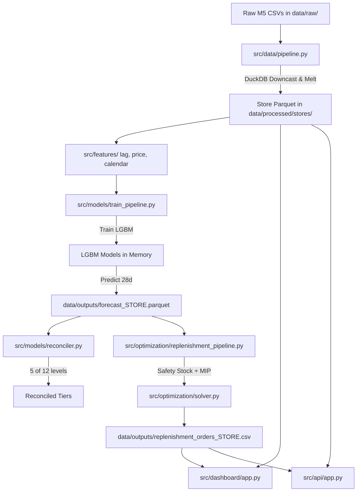

# Initial Repository Forensic Audit Report
**Project:** Nationwide Demand Forecasting and Inventory Optimization Platform  
**Repository:** `nationwide-demand-forecasting-optimization`  
**Dataset:** Walmart M5 Forecasting Dataset  
**Audit Date:** 2026-11-09  
**Auditor:** Senior ML Engineer, Quantitative Forecasting Specialist & Backend Architect  

---

## 1. Executive Summary

This forensic audit evaluates the existing codebase of the Nationwide Demand Forecasting and Inventory Optimization platform against production standards, mathematical correctness, data integrity, and the full M5 competition and operational inventory specifications.

### Summary Assessment
* **Functional Foundation**: The repository contains a working modular skeleton with active data ingestion via DuckDB/Polars downcasting, LightGBM quantile training, basic OR-Tools optimization, FastAPI endpoints, Plotly Dash dashboard components, and 6 passing unit tests.
* **Integrity & Mathematical Defects Identified**:
  1. **Causal Price Leakage**: `pipeline.py` uses `.bfill()` across items, leaking future prices to impute unobserved historical prices before product launch.
  2. **Inventory Balance Formulation Mismatch**: `solver.py` carries over negative inventory ($I_{pos} - I_{neg}$) into the next period, mathematically modeling an **unrestricted backorder/backlog** system rather than a **lost-sales** retail hypermarket model.
  3. **Hierarchical Reconciliation Incompleteness**: `reconciler.py` only implements 5 aggregate levels out of the 12 official M5 competition levels, omitting State $\times$ Category, State $\times$ Department, Item total, and Item $\times$ State.
  4. **Metric Substitution**: `metrics.py` implements single-series RMSSE and WAPE, but lacks the true **Weighted Root Mean Squared Scaled Error (WRMSSE)** which requires scale denominators and cumulative dollar sales weights across all 42,840 series.
  5. **Model Persistence Gap**: Trained LightGBM boosters are kept in memory or dumped only as test forecast Parquet tables; serializable model artifacts (`.booster` or pickle) with metadata and versioning are not persisted for the API.
  6. **Quantile Crossing**: LightGBM quantile models ($P_{10}, P_{50}, P_{90}$) are trained independently without monotonic sorting or isotonic calibration, allowing potential quantile inversions ($P_{10} > P_{50}$).
  7. **API Contract Gaps**: The FastAPI endpoints in `src/api/app.py` do not match the required REST contract (missing `/health`, `/api/v1/hierarchy`, `/api/v1/forecasts/{id}`, `/api/v1/models`, `/api/v1/metrics`, and use wildcard CORS `*`).

---

## 2. Module Inventory and Implementation Status Matrix

| Module | File Path | Current Status | Implemented Functionality | Gaps / Missing Capabilities |
|---|---|---|---|---|
| **Downcaster** | `src/data/downcaster.py` | Partially Hardened | Numeric & object downcasting (uint8-uint32, int8-int32, float32, category) | Uses deprecated `is_categorical_dtype`; no explicit outlier or extreme value bounds checks. |
| **Data Ingestion** | `src/data/pipeline.py` | Partially Implemented / Bugged | DuckDB loading, wide-to-long melt, calendar & price join, Snappy Parquet partitioning | **Critical bug: `.bfill()` on prices causes future price leakage**. No automated data-quality report or duplicate/schema validation. |
| **Lag Generator** | `src/features/lag_generator.py` | Working Baseline | Lags (28, 29, 30, 35, 42, 56), rolling means/std, EWMA shifted $\ge 28$ days | Missing Lag 84, Lag 364 (annual seasonality), 56-day rolling window, zero-streak run-length encoding. |
| **Price Features** | `src/features/price_feats.py` | Working Baseline | Rolling 28-day max, discount ratio, 7-day price difference | Requires strict forecast-origin boundary verification to avoid unobserved weekly price leakage. |
| **Calendar Features** | `src/features/calendar_feats.py` | Working Baseline | Day of month, weekend flag, cyclical sin/cos wday/month, categorical codes | Missing week of year (`isocalendar().week`), calendar year, and secondary events (`event_name_2`). |
| **Base Forecaster** | `src/models/base.py` | Implemented | Abstract Base Class defining `fit()`, `predict()`, `predict_quantiles()` | Needs serialization interface (`save()`, `load()`). |
| **LightGBM Engine** | `src/models/lgbm_forecaster.py` | Working Baseline | Tweedie point model, P10/P50/P90 quantile regressors, feature importances | No quantile crossing correction; no persistent serialization/deserialization methods; hyperparameters hardcoded. |
| **Prophet Engine** | `src/models/prophet_engine.py` | Prototype / Isolated | Single-series Prophet model with US holidays and trend extraction | Not integrated into training/backtesting pipeline; not benchmarked against naive baselines. |
| **TFT Engine** | `src/models/tft_forecaster.py` | Prototype / Isolated | Darts `TFTModel` wrapper with quantile loss | Not integrated into production pipeline; no automated data converter from wide panel to multi-series covariates. |
| **Reconciler** | `src/models/reconciler.py` | Incomplete | Bottom-up reconciliation for 5 of 12 levels; pairwise coherence check | **Missing 7 of 12 M5 levels**; MinT/WLS covariance reconciliation is only in blueprint, not in code. |
| **Train Pipeline** | `src/models/train_pipeline.py` | Working Baseline | Single-store walk-forward train/test split, LightGBM training, Parquet forecast export | Only evaluates single 28-day split; no rolling-origin evaluation; no model artifact persistence; no WRMSSE. |
| **Safety Stock** | `src/optimization/safety_stock.py` | Implemented | Normal distribution dynamic safety stock and ROP from quantile spread | Normal assumption must be explicitly documented; assumes constant lead-time distribution. |
| **MIP Solver** | `src/optimization/solver.py` | Mathematically Defective | OR-Tools CBC/SCIP solver, MOQ, capacity, budget, fixed order costs | **Mathematical defect: models backorders ($I_{pos} - I_{neg}$) instead of retail lost sales**. Continuous variables rounded. |
| **Replenishment Pipeline** | `src/optimization/replenishment_pipeline.py` | Working Baseline | Loads forecasts, extracts top 100 items, solves MIP, outputs CSV | Hardcoded simulated inventories and parameters without configurable runtime overrides. |
| **FastAPI Gateway** | `src/api/app.py` | Incomplete / Insecure | Health, hierarchy tree, forecast generate, replenish endpoints | Missing endpoints specified in prompt; wildcard CORS; health check does not check actual lake/model state. |
| **API Schemas** | `src/api/schemas.py` | Working Baseline | Pydantic models for health, hierarchy, forecast, and replenishment | Incomplete schema coverage for models, metrics, and individual forecast retrieval. |
| **Dashboard Layout** | `src/dashboard/layout.py` | Implemented | KPI cards, fan chart container, risk matrix container, order table, what-if sliders | Contains hardcoded placeholder strings in layout before first callback update. |
| **Dashboard Callbacks**| `src/dashboard/callbacks.py` | Implemented | Reactive fan chart, risk matrix scatter, table updates, slider reactivity | Connected to `data_loader.py` mock/sample generator rather than full persisted model registry. |
| **Dashboard Loader** | `src/dashboard/data_loader.py` | Partially Implemented | Reads store Parquet via DuckDB; generates sample item snapshot | Synthesizes fallback data when store is missing without explicit "Demo/Synthetic Mode" disclaimer. |
| **Metrics Engine** | `src/utils/metrics.py` | Incomplete | RMSSE, WAPE, Pinball loss, multi-quantile loss | **Missing official 12-level WRMSSE**; missing MAE and RMSE. |
| **Logger** | `src/utils/logger.py` | Implemented | Standard console logging with timestamps and log levels | Working as intended. |
| **Test Suite** | `tests/` | Incomplete | 4 test files (6 unit tests total) | Only tests basic math on toy fixtures; no data pipeline, integration, API, or full optimization tests. |

---

## 3. End-to-End Execution Trace



### Trace Findings:
1. **Disconnected Reconciler**: The output of `src/models/reconciler.py` is not piped into the inventory optimization engine; `replenishment_pipeline.py` reads bottom-level raw forecasts directly from `forecast_CA_1.parquet`.
2. **Disconnected Models**: `prophet_engine.py` and `tft_forecaster.py` are standalone files not invoked by `run_system.py` or `train_pipeline.py`.
3. **API Dependency on In-Memory Re-computation**: The API endpoint `/api/v1/optimize/replenish` calls `calculate_safety_stock_and_rop` on the fly rather than reading validated persisted replenishment runs.

---

## 4. Key Defects, Vulnerabilities and Remediation Requirements

### 4.1 Critical Defect: Causal Price Leakage via Backward-Fill
* **Location**: `src/data/pipeline.py`, Line 125:
  ```python
  df_merged["sell_price"] = df_merged.groupby("item_id")["sell_price"].transform(
      lambda x: x.ffill().bfill()
  ).astype(np.float32)
  ```
* **Why this is invalid**: When an item has not yet been introduced in week $w_1$, backward-filling copies its future launch price from week $w_{launch} > w_1$ backwards into $w_1$. In reality, this price was completely unobservable at $w_1$.
* **Remediation**:
  1. Prices should be forward-filled (`ffill()`) strictly from the first historical observation date.
  2. Before product launch, `sell_price` must be marked as `np.nan` or $0.0$, accompanied by an explicit boolean indicator `is_active_item = 0`.
  3. Lags and rolling metrics must exclude non-active periods.

### 4.2 Critical Defect: Backorders vs. Lost Sales Formulation in MIP Solver
* **Location**: `src/optimization/solver.py`, Line 114:
  ```python
  prev_inv = initial_inventories[i] if t == 0 else (I_pos[i, t - 1] - I_neg[i, t - 1])
  ```
* **Why this is invalid**: If demand $D_{t-1} = 20$ and available inventory was $10$, then $I_{pos}[t-1] = 0$ and $I_{neg}[t-1] = 10$. In the current formulation, starting inventory for day $t$ is $0 - 10 = -10$. This means arriving orders must first pay off the 10 units of unsatisfied past demand (backorders). In retail hypermarkets like Walmart, unmet demand is **lost sales** (the customer leaves or buys an alternative); the next morning, shelf inventory starts at $\max(0, I_{t-1}) = I_{pos}[t-1] = 0$, NOT $-10$.
* **Remediation**: Correct the balance constraint to:
  $$\text{Ending Inventory } I_{pos}[i, t] = I_{pos}[i, t-1] + Q_{i, t - L_i} - \text{Sales}[i, t]$$
  $$\text{Sales}[i, t] \le D_{i, t}$$
  $$\text{Sales}[i, t] \le I_{pos}[i, t-1] + Q_{i, t - L_i}$$
  $$\text{Lost Sales } I_{neg}[i, t] = D_{i, t} - \text{Sales}[i, t]$$
  $$I_{pos}[i, t] \ge 0, \quad I_{neg}[i, t] \ge 0$$
  This rigorously guarantees nonnegative physical inventory without accumulating phantom backorders.

### 4.3 Missing Official M5 Evaluation Metric (WRMSSE)
* **Location**: `src/utils/metrics.py`
* **Why this is invalid**: The M5 competition does not evaluate models on simple item-level WAPE or average RMSSE. It evaluates a single scalar **WRMSSE** across all 12 aggregation levels, where:
  * Each series $k \in \{1 \dots 42,840\}$ has an in-sample scale denominator:
    $$S_k = \frac{1}{n-1} \sum_{t=2}^n (y_{k,t} - y_{k,t-1})^2$$
  * Each series has a revenue weight $W_k$ calculated using the last 28 days of historical sales revenue:
    $$W_k = \frac{\sum_{t=n-27}^n P_{k,t} \cdot y_{k,t}}{\sum_{j=1}^{42840} \sum_{t=n-27}^n P_{j,t} \cdot y_{j,t}}$$
  * $\text{WRMSSE} = \sum_{k=1}^{42840} W_k \sqrt{\frac{1}{h} \sum_{t=n+1}^{n+h} \frac{(y_{k,t} - \hat{y}_{k,t})^2}{S_k}}$
* **Remediation**: Build the full, verified 12-level WRMSSE calculator that computes true M5 weights and denominators.

### 4.4 Incomplete Hierarchical Reconciliation (Only 5 of 12 Levels)
* **Location**: `src/models/reconciler.py`
* **Missing Levels**:
  * Level 4: Category Totals (FOODS, HOBBIES, HOUSEHOLD)
  * Level 5: Department Totals (7 series)
  * Level 6: State $\times$ Category (9 series)
  * Level 7: State $\times$ Department (21 series)
  * Level 10: Product Total across all stores (3,049 series)
  * Level 11: Product $\times$ State (9,147 series)
  * Level 12: Product $\times$ Store (30,490 series)
* **Remediation**: Implement the full 12-level structural aggregation and reconciliation matrix.

---

## 5. Audit of Existing Test Suite

| Test File | Test Name | What It Actually Tests | Critical Limitations |
|---|---|---|---|
| `test_feature_leakage.py` | `test_no_temporal_leakage_in_lags` | Checks that `sales_lag_28` is NaN at index 0 on a 60-row toy series | Does not test multiple forecast origins, does not test price leakage, does not test rolling feature bounds. |
| `test_metrics.py` | `test_calculate_wape` | Verifies scalar arithmetic on 3 numbers: `[10, 20, 30]` | Does not test zero-division, multi-dimensional series, or WRMSSE. |
| `test_metrics.py` | `test_pinball_loss_symmetry` | Checks that pinball loss at $q=0.5$ equals $0.5 \times \text{MAE}$ on 2 numbers | Does not test extreme quantiles ($0.1, 0.9$) or quantile crossing. |
| `test_metrics.py` | `test_calculate_rmsse` | Checks that zero error returns 0.0 RMSSE | Does not test scale denominators or zero-sale series. |
| `test_optimizer.py` | `test_or_tools_solver_feasibility` | Runs 2-item 3-day MIP solver and checks status is OPTIMAL | Uses backorder equation; does not test capacity bounds, budget exhaustion, or lead-time delays. |
| `test_reconciliation.py` | `test_bottom_up_coherence` | Checks Bottom-Up summation on 2 stores and 2 departments | Only tests 2 arbitrary levels; does not test the 12 M5 levels. |

---

## 6. Documented Data Limitations & Operational Assumptions

The Walmart M5 dataset on Kaggle provides Point-of-Sale (POS) unit transactions, calendar events, SNAP benefits, and weekly unit sell prices. It does **not** provide:
1. Physical warehouse/store starting inventory levels.
2. Supplier lead times ($L_i$) or lead-time variance.
3. Minimum Order Quantities (MOQ) or case-pack multiples.
4. Physical unit cubic volumes ($m^3$).
5. Actual wholesale procurement costs ($c_{unit, i}$).
6. Store warehouse cubic capacity limits.

**Policy Decision**: In order to execute mathematical inventory optimization without fabricating fake historical facts, the platform implements an **explicit, configurable operational assumption layer** (`config/base_config.yaml` and default parameters):
* Wholesale unit costs are assumed at $65\%$ of the observable retail price ($\text{margin} = 35\%$).
* Supplier lead times are assumed to follow $L_i \sim \text{Poisson}(\lambda=3 \text{ days})$.
* Starting inventory is modeled as a service-level target fraction of historical 14-day velocity.
* All assumptions are explicitly documented and labeled in both the API metadata and the Dashboard UI.

