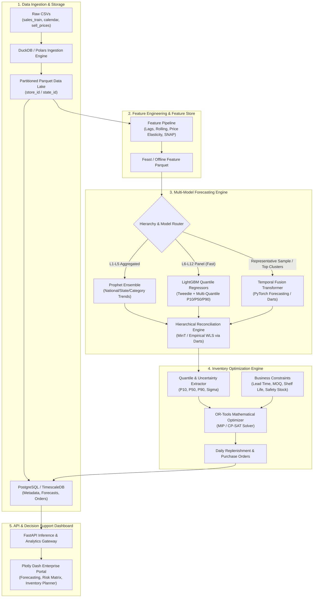
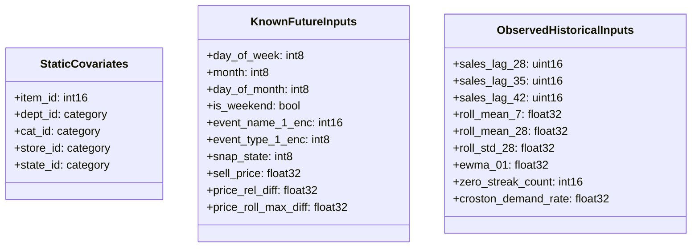
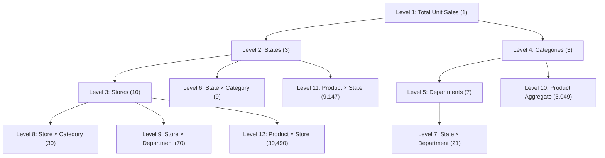
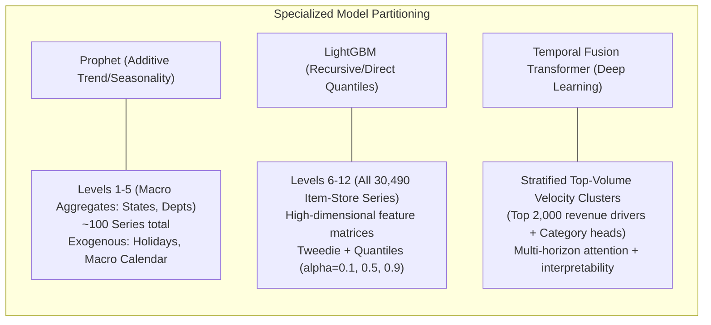
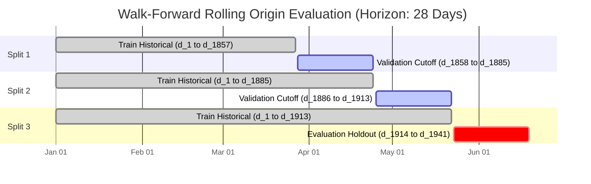
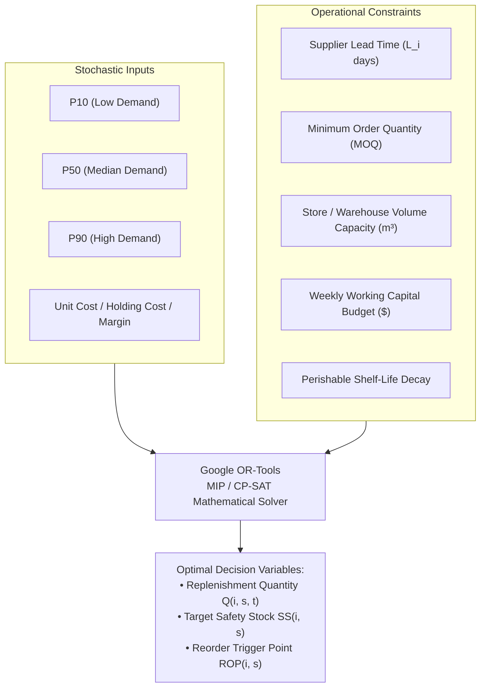
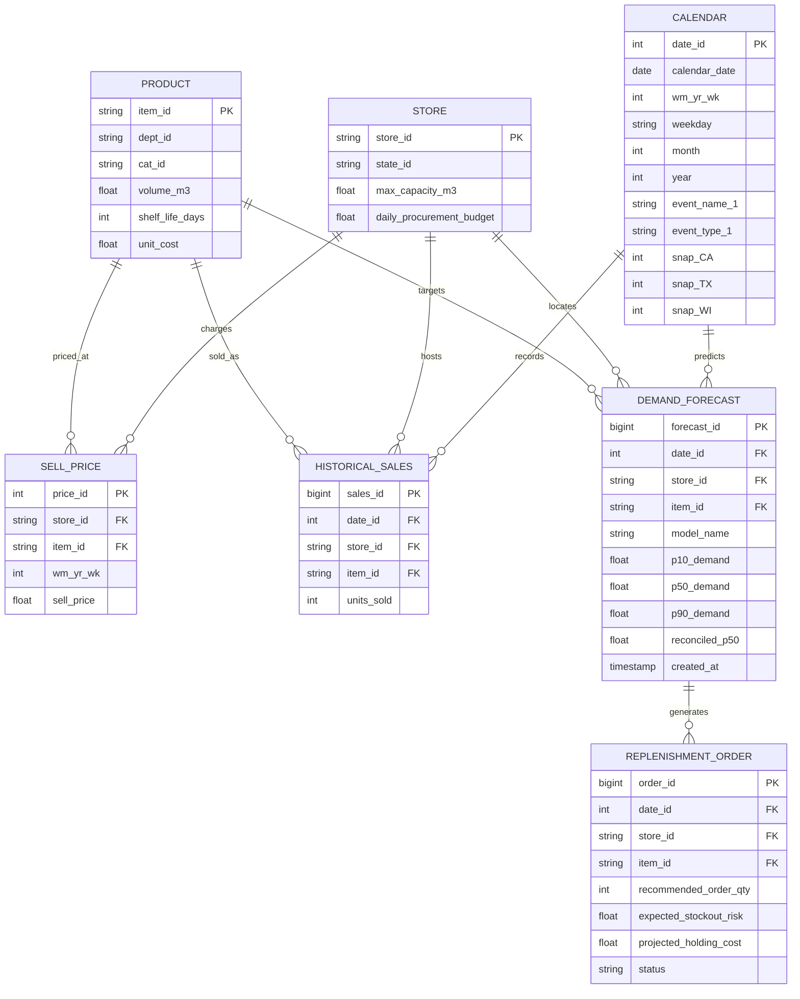
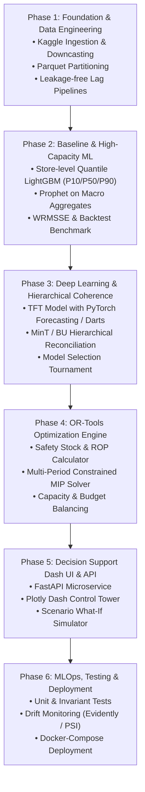

# Nationwide Demand Forecasting and Inventory Optimization Platform
## Industrial-Grade Architectural Blueprint & System Specification

---

## 1. Executive Summary & Problem Framing

### 1.1 Business Objective
The platform solves a fundamental retail supply chain challenge: **simultaneously minimizing lost sales (stockouts) and carrying costs (excess inventory/spoilage)** across a multi-tier retail network. By combining hierarchical probabilistic demand forecasting with constrained mathematical optimization, the system transforms historical POS (Point of Sale) telemetry into actionable daily store-level replenishment orders.

```
                              ┌────────────────────────────────────────┐
                              │  Point of Sale & Price Data (M5 / POS) │
                              └───────────────────┬────────────────────┘
                                                  ▼
                              ┌────────────────────────────────────────┐
                              │   Hierarchical Time Series Features    │
                              └───────────────────┬────────────────────┘
                                                  ▼
                              ┌────────────────────────────────────────┐
                              │ Probabilistic Forecasting (P10/P50/P90)│
                              │      LightGBM | TFT | Prophet          │
                              └───────────────────┬────────────────────┘
                                                  ▼
                              ┌────────────────────────────────────────┐
                              │   Hierarchical Coherent Reconciliation  │
                              │          (MinT / Bottom-Up)            │
                              └───────────────────┬────────────────────┘
                                                  ▼
                              ┌────────────────────────────────────────┐
                              │ Constrained Replenishment Optimization │
                              │          (Google OR-Tools)             │
                              └───────────────────┬────────────────────┘
                                                  ▼
                              ┌────────────────────────────────────────┐
                              │ Dash Executive & Operational Dashboard │
                              └────────────────────────────────────────┘
```

### 1.2 M5 Dataset Scale & Empirical Challenges
The Kaggle M5 dataset replicates Walmart unit sales across:
* **Scope**: 3 States (`CA, TX, WI`), 10 Stores, 3 Categories (`HOBBIES, FOODS, HOUSEHOLD`), 7 Departments, and 3,049 unique items.
* **Granularity**: 30,490 bottom-level time series tracked across 1,913 historical days (equivalent to ~58.3 million unit sale observations).
* **Sparse & Intermittent Demand**: Over 68% of daily bottom-level records represent zero sales; Poisson/Tweedie distributed with sudden spikes (promotions, SNAP subsidy days).
* **Hierarchical Structure**: 12 aggregated aggregation levels defined in the official M5 competition specification, ranging from National aggregate (Level 1) down to Item-Store unit sales (Level 12).
* **Dual Exogenous Drivers**:
  * Event/Calendar signals: National/religious holidays, cultural events, and state-level SNAP benefit disbursement cycles.
  * Pricing dynamics: Weekly store-level price elasticity, temporary discounts, and item launch/churn schedules.

---

## 2. End-to-End System Architecture

The solution adopts a decoupled, event-driven, micro-service-oriented batch architecture capable of operating both locally and on distributed cloud infrastructure.



---

## 3. Data Flow & Processing Pipeline

### 3.1 Data Flow Sequence
```mermaid
sequenceDiagram
    autonumber
    participant Source as Raw M5 Files
    participant ETL as Polars/DuckDB ETL
    participant Lake as Parquet Data Lake
    participant Feat as Feature Engineering
    participant Model as Forecast Engines (LGBM/TFT/Prophet)
    participant Recon as Hierarchical Reconciler
    participant Opt as OR-Tools Inventory Engine
    participant DB as Postgres Data Store
    participant UI as Plotly Dash UI

    Source->>ETL: Stream calendar, prices, sales
    ETL->>Lake: Downcast types (int16/float32) & Partition
    Lake->>Feat: Extract sliding window arrays
    Feat->>Model: Feed static, known future, and historical lags
    Model->>Recon: Raw Level 1..12 Quantile Forecasts
    Recon->>Opt: Coherent P10, P50, P90 + Variance
    Opt->>DB: Optimal Order Quantities & Inventory Metrics
    DB->>UI: Serve Dashboards, Alert Stockouts & Surpluses
```

### 3.2 Ingestion & Memory Optimization Strategy
The M5 dataset in wide format (`sales_train_evaluation.csv`) contains 30,490 rows and 1,941 day columns. Unpivoting this naively into a long format creates **~59.2 million records**, which easily triggers Out-Of-Memory (OOM) errors in 16GB–32GB RAM machines if stored as standard 64-bit types.

#### Concrete Downcasting Matrix:
| Field | Raw Type | Optimized Type | Memory Reduction |
|---|---|---|---|
| `id`, `item_id`, `store_id`, `state_id` | `object` / `string` | `category` / dictionary-encoded `int16` | ~85% |
| `dept_id`, `cat_id` | `object` | `category` | ~90% |
| `d` (day index) | `string` (`"d_1914"`) | `uint16` (`1914`) | ~75% |
| `sales` | `int64` | `uint16` / `int16` | ~75% |
| `sell_price` | `float64` | `float32` | ~50% |
| `wm_yr_wk` | `int64` | `uint16` | ~75% |
| `snap_CA`, `snap_TX`, `snap_WI` | `int64` | `int8` / `bool` | ~87.5% |

**Data Pipeline Flowchart:**


---

## 4. Time Series Feature Engineering

To support LightGBM, Temporal Fusion Transformer (TFT), and linear baselines, features are grouped into three distinct temporal categories matching the TFT taxonomy:



### Feature Categories:
1. **Lags & Shifted Windows**:
   * Minimum lag index = 28 days (to ensure complete operational forecast horizon compatibility without data leakage).
   * Lags: `t-28`, `t-29`, `t-35`, `t-42`, `t-56`.
2. **Rolling & Exponential Moving Averages**:
   * Rolling means, standard deviations, and min/max computed over shifted series: Windows of 7, 14, 28, 60, and 90 days.
   * Exponential Weighted Moving Average (EWMA) with $\alpha \in \{0.1, 0.3\}$.
3. **Price Dynamics & Elasticity**:
   * Discount ratio: $P_{current} / P_{rolling\_max\_4\_weeks}$.
   * Price volatility: percentage change week-over-week.
4. **Intermittent / Zero-Inflation Signatures**:
   * Continuous zero-sale count (run-length encoding of zero demand).
   * Croston-based interval demand estimate: separates transaction probability from transaction volume.

---

## 5. Hierarchical Forecasting Framework

### 5.1 The 12 M5 Hierarchy Levels
The M5 dataset forms an exact nested structural hierarchy:

```
Level 1:  National Aggregate (Total Walmart Sales across all products & stores)
Level 2:  State Totals (CA, TX, WI) [3 series]
Level 3:  Store Totals (10 series)
Level 4:  Category Totals (FOODS, HOBBIES, HOUSEHOLD) [3 series]
Level 5:  Department Totals (7 series)
Level 6:  State x Category [9 series]
Level 7:  State x Department [21 series]
Level 8:  Store x Category [30 series]
Level 9:  Store x Department [70 series]
Level 10: Product Total across all stores [3,049 series]
Level 11: Product x State [9,147 series]
Level 12: Product x Store (Bottom Level) [30,490 series]
Total Cross-Sectional Series: 42,840
```



### 5.2 Hierarchical Reconciliation Strategy
Independent bottom-up forecasts frequently fail to capture macro-economic trends, while top-down models lose item-level variance. 
Let $\boldsymbol{y}_t$ be the vector of all 42,840 series at time $t$, and $\boldsymbol{b}_t$ be the bottom-level 30,490 series:
$$\boldsymbol{y}_t = \boldsymbol{S} \boldsymbol{b}_t$$
where $\boldsymbol{S}$ is the $42,840 \times 30,490$ structural summing matrix.

**Reconciliation Approaches:**
1. **Bottom-Up (BU)**: Sum Level 12 forecasts upwards. Computationally simple, unbiased if base forecasts are unbiased, but noisy for macro planning.
2. **Minimum Trace (MinT) Optimal Reconciliation** (via **Darts** / **HierarchicalForecast**):
   $$\tilde{\boldsymbol{y}}_t = \boldsymbol{S}(\boldsymbol{S}^T \boldsymbol{W}^{-1} \boldsymbol{S})^{-1} \boldsymbol{S}^T \hat{\boldsymbol{y}}_t$$
   Where $\boldsymbol{W}$ is the covariance matrix of base forecast errors.
   * *Computational Challenge*: An exact $42,840 \times 42,840$ matrix inversion is prohibitive in real-time.
   * *Production Solution*: Use **Shrinkage Covariance** or **Structural WLS (Weighted Least Squares)** where $\boldsymbol{W} \approx \text{diag}(\boldsymbol{S} \boldsymbol{1})$, scaling linearly with series count.

---

## 6. Multi-Model Machine Learning Architecture

To honor the mandatory technologies while avoiding compute failure, we assign each technology to its operational sweet spot:



### 6.1 Model Architecture Details

#### 1. LightGBM (Primary High-Capacity Bottom-Level Workhorse)
* **Objective Function**:
  * Point estimates: `tweedie` objective (Tweedie variance power $p \in [1.1, 1.3]$), perfectly tuned for zero-inflated continuous counts.
  * Prediction intervals: Asymmetric Pinball / Quantile loss with $\alpha \in \{0.10, 0.50, 0.90\}$.
* **Training Strategy**: 10 distinct models trained per store (partitioned training) or 1 single cross-store panel model with store embeddings. Store-partitioned training reduces training memory to $< 3\text{ GB}$ per store.

#### 2. Temporal Fusion Transformer (TFT via PyTorch Forecasting & Darts)
* **Role**: Captures complex non-linear temporal interactions, cross-department seasonality, and promotional decay.
* **Architecture**:
  * Variable Selection Networks (VSN) for feature gating.
  * Static Covariate Encoders (item embeddings, store categorical embeddings).
  * Gated Residual Networks (GRN) and Multi-Head Self-Attention across 28-day future horizon.
  * Quantile outputs directly emitted via multi-quantile loss head ($\tau = [0.1, 0.5, 0.9]$).

#### 3. Prophet (Aggregated Macro Trends)
* **Role**: Decomposes structural macro trends, multi-frequency seasonality (yearly, weekly), and event impact at Levels 1 through 5.
* **Execution**: Fast multi-threaded fitting across aggregated series using Python `concurrent.futures`.

---

## 7. Backtesting, Evaluation & Model Selection

### 7.1 Cross-Validation Strategy (Rolling-Origin Window)
We employ a **Time-Series Expanding Window (Walk-Forward) Backtest** to prevent temporal leakage:



### 7.2 Evaluation Metrics
* **WRMSSE (Weighted Root Mean Squared Scaled Error)**: The official M5 evaluation metric. Normalizes scale across products using historical in-sample difference scales and weights errors by dollar sales value.
  $$\text{WRMSSE} = \sum_{k=1}^{42840} W_k \sqrt{\frac{\sum_{t=n+1}^{n+h} (y_{k,t} - \hat{y}_{k,t})^2}{\frac{1}{n-1} \sum_{i=2}^n (y_{k,i} - y_{k,i-1})^2}}$$
* **SPL (Scaled Pinball Loss / Quantile Loss)**: Evaluates calibrated coverage of $P_{10}$ and $P_{90}$ intervals.
* **WAPE (Weighted Absolute Percentage Error)**: Provides business-interpretable aggregate forecast accuracy.

---

## 8. Inventory Optimization Engine (OR-Tools MIP Formulation)

Demand forecasts are not decisions. The Inventory Optimization Engine transforms probabilistic demand into optimal daily order quantities $Q_{i,s,t}$ that minimize total holding, ordering, and penalty costs subject to supply chain constraints.



### 8.1 Mathematical Optimization Model

#### Objective Function:
Minimize the expected operational cost over horizon $T = 28$ days across all items $i$ and stores $s$:
$$\min \sum_{t=1}^T \sum_{s=1}^S \sum_{i=1}^I \left( C_{order} \cdot Y_{i,s,t} + c_{unit,i} \cdot Q_{i,s,t} + h_{i} \cdot I_{i,s,t}^+ + p_{i} \cdot I_{i,s,t}^- \right)$$

Where:
* $Q_{i,s,t} \ge 0$: Units ordered for item $i$ at store $s$ arriving at day $t$.
* $Y_{i,s,t} \in \{0, 1\}$: Binary order setup indicator (fixed vendor replenishment charge $C_{order}$).
* $I_{i,s,t}^+$: Ending on-hand inventory (carrying holding cost $h_i$).
* $I_{i,s,t}^-$: Unmet demand / lost sales (shortage penalty $p_i$, where $p_i = \text{Price}_i - \text{Cost}_i + \text{Goodwill Penalty}$).
* Demand is modeled using probabilistic quantiles: $D_{i,s,t} \sim \mathcal{F}(P_{10}, P_{50}, P_{90})$.

#### Subject to Constraints:
1. **Inventory Balance Equation**:
   $$I_{i,s,t} = I_{i,s,t-1} + Q_{i,s,t - L_i} - D_{i,s,t}$$
   $$(I_{i,s,t} = I_{i,s,t}^+ - I_{i,s,t}^-)$$
2. **Order Quantity & MOQ Trigger**:
   $$Q_{i,s,t} \ge \text{MOQ}_i \cdot Y_{i,s,t}$$
   $$Q_{i,s,t} \le M \cdot Y_{i,s,t} \quad (\text{Big-M order ceiling})$$
3. **Physical Store / Warehouse Capacity**:
   $$\sum_{i=1}^I V_i \cdot I_{i,s,t}^+ \le \text{MaxCapacity}_s \quad \forall s, t$$
   *(where $V_i$ is unit volume in $m^3$)*
4. **Working Capital / Procurement Budget**:
   $$\sum_{i=1}^I c_{unit,i} \cdot Q_{i,s,t} \le \text{DailyBudget}_{s,t}$$
5. **Dynamic Safety Stock Buffer (Service Level Target $\beta = 95\%$):**
   $$SS_{i,s} = Z_{\beta} \cdot \sqrt{L_i \cdot \sigma_{D,i,s}^2 + \bar{D}_{i,s}^2 \cdot \sigma_{L,i}^2}$$
   Where uncertainty $\sigma_{D,i,s}$ is derived directly from the TFT/LightGBM interquartile range:
   $$\sigma_{D,i,s} \approx \frac{P_{90} - P_{10}}{2 \cdot 1.28155}$$

---

## 9. Database Schema & Entity-Relationship (ER) Diagram

A relational schema designed for PostgreSQL with TimescaleDB extensions for hyper-tables:



---

## 10. API Specification (FastAPI Gateway)

The platform exposes RESTful endpoints supporting both batch pipelines and interactive dashboard queries:

| Method | Endpoint | Description | Request Body / Query Params |
|---|---|---|---|
| `GET` | `/api/v1/health` | Service & database health checks | None |
| `GET` | `/api/v1/hierarchy/tree` | Returns hierarchical node relations | None |
| `POST` | `/api/v1/forecast/generate` | Triggers asynchronous 28-day forecast | `{ "model": "lgbm", "reconcile": true, "horizon": 28 }` |
| `GET` | `/api/v1/forecast/series` | Fetch historical + predicted quantiles | `?store_id=CA_1&item_id=FOODS_1_001&levels=12` |
| `POST` | `/api/v1/optimize/replenish` | Run OR-Tools replenishment solver | `{ "store_id": "CA_1", "service_level": 0.95, "budget_limit": 50000 }` |
| `GET` | `/api/v1/inventory/recommendations` | Get active purchase recommendations | `?store_id=TX_2&status=PENDING_APPROVAL` |
| `GET` | `/api/v1/analytics/risk-matrix` | High stockout/excess inventory matrix | `?state_id=WI&date=2016-05-23` |

---

## 11. Plotly Dash Dashboard Architecture

The interactive dashboard serves three key user personas: Executive Leadership, Regional Demand Planners, and Store Inventory Managers.

```
┌─────────────────────────────────────────────────────────────────────────────┐
│                       NATIONWIDE INVENTORY CONTROL TOWER                    │
│  [State: ALL ▼]  [Store: CA_1 ▼]  [Category: FOODS ▼]  [Horizon: 28 Days ▼] │
├─────────────────────────────────────────────────────────────────────────────┤
│  KPI CARDS                                                                  │
│  ┌────────────────┐ ┌────────────────┐ ┌────────────────┐ ┌────────────────┐│
│  │ Projected Sales│ │ Stockout Risk  │ │ Capital Requir.│ │ Overstock Units││
│  │   $1,420,500   │ │    2.4% (-1.1%)│ │    $342,100    │ │    1,120 (-8%) ││
│  └────────────────┘ └────────────────┘ └────────────────┘ └────────────────┘│
├─────────────────────────────────────────────────────────────────────────────┤
│  SECTION 1: HIERARCHICAL DEMAND FORECAST EXPLORER                           │
│  [Time-series Chart: History vs P10-P50-P90 Forecast Fan Chart + Events]   │
│  -------------------------------------------------------------------------  │
│  * Plotly Scatter with shaded confidence intervals (rgba(0,100,255,0.2))    │
│  * Drill-down from National -> State -> Store -> Department -> Item         │
├──────────────────────────────────────────────────────┬──────────────────────┤
│  SECTION 2: REPLENISHMENT PLANNER                    │ SECTION 3: RISK      │
│  [Interactive Ag-Grid / DataTable]                   │ MATRIX (P90 vs Cap)  │
│  - Item ID | Suggested Order | MOQ | Cost | Action   │ [Scatter Matrix]     │
│  - FOODS_1_001 | 120 units   | 50  | $240 | [Approve]│ Red: Critical Out    │
│  - HOBBY_2_042 | 0 units     | 20  | $0   | [Hold]   │ Yellow: Overstocked  │
│  - HOUSE_1_010 | 450 units   | 100 | $890 | [Approve]│ Green: Optimal       │
├──────────────────────────────────────────────────────┴──────────────────────┤
│  SECTION 4: OR-TOOLS CONSTRAINT WHAT-IF SIMULATOR                           │
│  Sliders: [Budget: $50,000] [Service Level: 95%] [Lead Time Buffer: +2 days]│
│  Button: [Re-run Optimization Engine]                                       │
└─────────────────────────────────────────────────────────────────────────────┘
```

---

## 12. Computational Feasibility & Realistic Hardware Strategy

### 12.1 The Computational Trap of M5
* **Naive TFT approach**: Training 30,490 separate deep learning models or a single multi-series TFT over 58 million rows requires multi-GPU clusters (4x A100s) and 64GB+ RAM, taking 18+ hours to train.
* **Naive MinT Matrix Inversion**: Inverting a $42,840 \times 42,840$ covariance matrix requires $O(N^3)$ operations $\approx 7.8 \times 10^{13}$ FLOPs, freezing single machines.

### 12.2 Production-Grade Realistic Mitigations
1. **Model Hierarchy Tiering**:
   * **LightGBM**: Trains across all 30,490 bottom-level series using **store-partitioned multi-threading** (10 parallel jobs, each taking ~4 minutes on a modern 8-core CPU).
   * **Temporal Fusion Transformer (TFT)**: Applied selectively to high-velocity / top-tier volume clusters (Class A items using Pareto/ABC analysis, accounting for 70% of total revenue) and category aggregates.
   * **Prophet**: Applied exclusively to Levels 1 to 5 (~100 aggregated time series), completing in under 2 minutes.
2. **Reconciliation Acceleration**:
   * Replace dense covariance MinT with **Structural Scaling / MinT-Sample with diagonal variance assumptions** or **Bottom-Up** aggregation across bottom-level LightGBM predictions.
3. **Sliding Window Chunking**:
   * Generate lag features on-the-fly inside PyTorch Dataset generator or DuckDB views rather than materializing a flat 58-million-row Pandas DataFrame in memory.

---

## 13. Production Project Structure

```
nationwide-demand-forecast/
├── .github/
│   └── workflows/
│       ├── ci-tests.yml
│       └── model-retrain.yml
├── config/
│   ├── base_config.yaml
│   ├── lgbm_config.yaml
│   ├── tft_config.yaml
│   └── optimization_config.yaml
├── data/
│   ├── raw/                   # Original M5 CSV files (git-ignored)
│   ├── processed/             # Partitioned Parquet data lake
│   └── outputs/               # Forecast dumps and replenishment CSVs
├── src/
│   ├── __init__.py
│   ├── data/
│   │   ├── downloader.py      # Automated Kaggle M5 dataset retrieval
│   │   ├── downcaster.py      # Int16/Float32 memory optimization
│   │   └── pipeline.py        # DuckDB / Polars ETL pipeline
│   ├── features/
│   │   ├── calendar_feats.py  # SNAP, holiday, and day-of-week encodings
│   │   ├── price_feats.py     # Discount elasticity and rolling prices
│   │   └── lag_generator.py   # Shifted lags, EWMA, and Croston statistics
│   ├── models/
│   │   ├── base.py            # Abstract Base Forecaster class
│   │   ├── lgbm_forecaster.py # Quantile LightGBM engine
│   │   ├── tft_forecaster.py  # PyTorch Forecasting / Darts TFT engine
│   │   ├── prophet_engine.py  # High-level hierarchical Prophet models
│   │   └── reconciler.py      # MinT & Bottom-Up hierarchical reconciler
│   ├── optimization/
│   │   ├── solver.py          # Google OR-Tools MIP replenishment solver
│   │   ├── safety_stock.py    # Analytical buffer and ROP calculator
│   │   └── constraints.py     # Warehouse capacity & budget definitions
│   ├── api/
│   │   ├── app.py             # FastAPI entrypoint
│   │   ├── schemas.py         # Pydantic request/response models
│   │   └── routes/            # Endpoints for forecasts and orders
│   ├── dashboard/
│   │   ├── index.py           # Plotly Dash application layout
│   │   ├── callbacks.py       # Interactive filters and drill-down callbacks
│   │   └── components/        # Reusable charts, fan charts, and tables
│   └── utils/
│       ├── metrics.py         # WRMSSE, WAPE, and Scaled Pinball Loss
│       └── logger.py          # Structured logging configuration
├── tests/
│   ├── test_data_pipeline.py
│   ├── test_feature_leakage.py
│   ├── test_reconciliation.py
│   └── test_optimizer.py
├── notebooks/                 # Exploratory data analysis & prototyping
├── docker/
│   ├── Dockerfile.api
│   ├── Dockerfile.dashboard
│   └── docker-compose.yml
├── requirements.txt
├── pyproject.toml
└── README.md
```

---

## 14. Development Roadmap & Phased Execution



---

## 15. Risk Assessment & Mitigation Matrix

| Category | Identified Risk | Impact | Mitigation Strategy |
|---|---|---|---|
| **Data Engineering** | Out-of-memory during wide-to-long transformation | Critical | Use streaming Polars/DuckDB downcasting and write directly to partitioned Parquet files. |
| **Data Leakage** | Future pricing or lag values leaking into test horizon | High | Enforce strict 28-day minimum lag offsets ($t - 28$); separate features by static, known future, and observed past. |
| **Modeling** | TFT training takes excessive hours on CPU/standard GPU | High | Train TFT on representative Pareto Class A items; rely on fast multi-core LightGBM for the 30,490 bottom series. |
| **Hierarchical** | Incoherent top vs. bottom forecasts causing conflicting plans | Medium | Enforce structural summing matrix constraints via MinT shrinkage reconciliation. |
| **Optimization** | OR-Tools MIP solver fails to converge on 30,000 items | High | Decompose problem per store and solve 10 independent daily MIPs; use warm starts and time limits ($< 60\text{s}$ per store). |
| **Operations** | Phantom inventory & zero-sales streaks misguiding orders | Medium | Include Croston zero-streak features and minimum safety stock constraints. |
